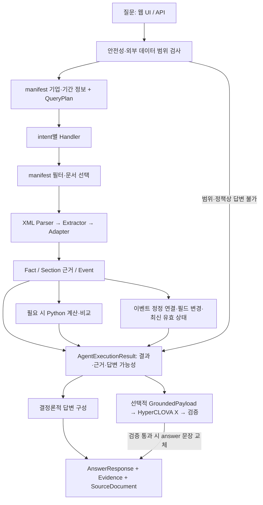

# DART 공시 AI Agent

금융감독원 DART 공시를 기반으로 재무 수치와 기업 활동을 조회하고, 비교·계산 결과를 원문 근거와 함께 제공하는 질의응답 시스템입니다. 정기공시, 공급계약·신규시설투자 등 거래소공시, 대량보유 보고서를 처리합니다. XML의 문서·Section·표 구조를 보존해 사실을 추출하고, 수치 계산과 정정공시의 변경 추적은 Python 코드로 수행합니다. HyperCLOVA X는 확정된 사실을 자연어로 표현하며, 문서나 근거를 확정할 수 없는 요청에는 임의의 값을 만들어 답하지 않습니다.

## 해결 방법과 시스템 흐름

공시의 숫자는 단위, 연결/별도 기준, 보고 기간, 정정 여부에 따라 의미가 달라집니다. 이 프로젝트는 XML을 단순 텍스트 조각으로만 다루지 않고, **값의 의미와 원문 위치를 함께 보존하는 구조화 처리**를 중심으로 설계했습니다.



문서 선택은 `retrieval/metadata_filter.py`, 실행 경로 선택은 `agent/router.py`의 Handler 등록표가 담당합니다. 질의 해석, 원문 추출, 계산, 표현 단계의 책임을 구분하며, 지원하지 않는 요청을 다른 유형의 질문으로 바꿔 처리하지 않습니다.

## 핵심 기술

### XML 구조와 Evidence 보존

정기공시 Parser는 `metadata`, `sections`, `table_groups`, `tables`를 생성합니다. 셀의 `ACODE`, `ACONTEXT`, `ROWSPAN`, `COLSPAN`을 보존하고, Extractor는 병합 헤더와 단위 선언을 함께 읽어 수치의 기간·회계기준을 판정합니다.

```text
XML → Section 계층 → Table / 행 / 열 → 원문 값·단위·기간 → Fact + Evidence
```

실행 계약은 [common/schemas.py](src/disclosure_agent/common/schemas.py)에 정의되어 있습니다.

| 계약 | 역할 |
|---|---|
| `Fact` | `raw_value`·`raw_unit`과 정규화된 값·단위를 분리하고, 기간·회계기준·`evidence_ids`를 기록 |
| `Evidence` | `doc_id`, `section_path`, 행·열 label, 원문 발췌와 근거 위치를 연결 |
| `EvidenceProvenance` | 제공 가능한 표·행·열 인덱스, ACODE/ACONTEXT, 단위 선언·배수·신뢰 여부를 보존 |
| `SourceDocument` | 실제 선택한 문서의 보고서명·회계연도·종료월·접수번호·공시일을 `Evidence.doc_id`로 연결 |
| `RawReference` | 정정공시에 적힌 원공시일·정정일·정정사유·관련 공시 표기를 연결 전 상태로 보존 |

근거 필드의 채움 범위는 문서와 추출 경로에 따라 다릅니다. 원문에 없는 metadata를 질문이나 식별자에서 추정해 채우지 않습니다.

### 정기공시 조회·계산

- **단건 수치 조회:** 사업보고서의 매출액·영업이익, 분기·반기보고서의 누적 매출액. 연결/별도 기준과 원문 단위를 확인합니다.
- **연간 비교:** 기업 간 매출액·영업이익률 비교, 연도 간 매출 증감액·증감률과 영업이익률 변화 계산. 입력의 단위·기간·회계기준이 비교 가능한지 확인합니다.
- **사업내용 조회:** 사업의 개요·주력 제품·설비투자 등 지원되는 Section 범위의 내용과 원문 근거를 제공합니다.
- **결정론적 계산:** 원천 Fact와 계산 결과를 구분하고, `Decimal` 기반 Python 계산을 사용합니다. LLM이 숫자를 직접 계산하지 않습니다.

명시적 보고서 요청의 기간 계약은 다음과 같습니다. 두 분기보고서는 새 subtype 없이 종료월로 구분합니다.

| 요청 | `document_subtype` | `base_month` | 조회 기간 |
|---|---|---:|---|
| 1분기보고서 | `quarter` | 3 | 1~3월 누적, `3M YTD` |
| 반기보고서 | `half` | 6 | 1~6월 누적, `6M YTD` |
| 3분기보고서 | `quarter` | 9 | 1~9월 누적, `9M YTD` |
| 사업보고서 | `annual` | 12 | 연간 FY |

`QueryPlan.fiscal_base_month`는 단건 조회 Handler를 거쳐 locator의 `base_month`로 전달됩니다. 요청한 월의 문서가 없으면 다른 분기 문서를 대신 선택하지 않습니다. 상대 연간 기간은 시스템 날짜가 아니라 기업별 corpus의 최신 사업보고서 회계연도를 기준으로 해석합니다.

### 이벤트·정정공시 추적

공급계약의 금액·기간 조회, 신규시설투자 내용 조회, 지원되는 시설투자 합산·기업 비교 및 정정 이력을 처리합니다. 대량보유 보고서의 보유주식 수·보유비율 조회도 별도 `holding` 경로로 제공합니다.

```text
원공시 → 정정공시 → 추가 정정공시
       → EventLink / EventHistory / FieldChange
       → ResolvedEventState: 필드별 최신값 + 해당 값의 문서·Evidence
```

`event/linker.py`의 `build_filing_chain`이 문서 관계를 구성하고, `diff_correction`이 정정 필드를 해석합니다. `resolve_latest_event_state`는 완결된 체인에 명시된 변경을 적용하며, `resolve_original_event_state`는 원공시 당시 상태를 제공합니다. 따라서 최신 유효 상태의 각 필드는 서로 다른 문서를 근거로 가질 수 있습니다. 연결 후보가 모호하거나 체인이 불완전하면 최신값을 확정하지 않습니다.

### Fail-closed와 답변 가능성

답변 가능성과 실행 상태는 별개의 계약입니다.

| `AnswerResponse.status` | 의미 |
|---|---|
| `ANSWERABLE` | 확보한 근거로 답변 가능 |
| `PARTIALLY_ANSWERABLE` | 일부만 근거로 뒷받침 가능 |
| `UNANSWERABLE` | 데이터·정책·비교 가능성 등의 이유로 답변 불가 |
| `UNRESOLVED` | 문서 후보나 연결 관계를 하나로 확정하지 못함 |

내부 `AgentExecutionResult.execution_status`는 `COMPLETED`, `BLOCKED`, `FAILED`를 사용합니다. 정상 실행도 답변 불가로 끝날 수 있습니다. 문서·기간·필수 근거·정정 관계를 확정하지 못하면 기존 사유 코드로 종료하며, 첫 후보나 비슷한 기간의 값으로 대체하지 않습니다.

### HyperCLOVA X와 결정론적 fallback

HyperCLOVA X에는 raw XML 전체가 아니라 추출·계산을 마친 `GroundedPayload`를 전달합니다. `verbalizer.validate_answer`는 모델 출력의 JSON 형식, 참조 ID, 숫자, 기업·기간·지표 결합, 정정 이력 의미와 근거 밖 주장을 검사합니다.

설정 누락, 호출 실패, 출력 검증 실패 시 이미 구성된 결정론적 답변을 사용합니다. 모델 표현이 채택되어도 `answer` 문장만 교체하며 Fact·Evidence·답변 가능성 상태는 바꾸지 않습니다. 외부 LLM 없이도 구조화 조회와 답변이 동작합니다.

## 프로젝트 구조

```text
src/disclosure_agent/
├── common/       # Pydantic 계약, enum, 설정·날짜 처리
├── periodic/     # 정기공시 XML 파싱, 재무 추출, Section 선택, adapter
├── event/        # 거래소공시 파싱·추출, 정정 연결·차이·유효 상태
├── holding/      # 대량보유 보고서 파싱·추출
├── retrieval/    # manifest 필터, 문서 후보 조회·경로 해석
├── agent/        # QueryPlan, intent별 handler, 계산·근거·안전성·LLM 표현
└── api/          # FastAPI, 주최측 adapter, 정적 웹 UI
evaluation/      # 대표 질문·gold, 평가 runner, 별도 generalization 평가셋
tests/           # unit, integration, evaluation, 합성 fixture
scripts/         # 설치·서버·테스트 실행, corpus 회귀·감사 도구
docs/            # 설계 결정, XML 분석, 평가·배포 문서
data/            # 로컬 corpus와 가공 결과 위치
```

현재 조회의 중심은 manifest 필터와 문서 구조 탐색입니다. `retrieval/keyword.py`, `vector.py`, `fusion.py`는 인터페이스만 있으며, 범용 keyword/vector 검색이나 hybrid RAG를 구현한 시스템으로 간주하지 않습니다.

## 설치와 실행

Python **3.12**와 **uv**, 별도로 준비한 DART corpus가 필요합니다. 저장소 루트에서 실행합니다.

```bash
uv sync
cp .env.example .env

# 아래 데이터 구조에 맞춰 별도 corpus를 배치한 뒤 실행
export DISCLOSURE_CORPUS_ROOT=./data/raw/corpus
uv run uvicorn disclosure_agent.api.main:app --host 0.0.0.0 --port 8000
```

브라우저에서 `http://127.0.0.1:8000/`을 열면 웹 UI를 사용할 수 있습니다. UI는 같은 FastAPI가 HTML/JavaScript/CSS를 제공하므로 별도 프런트엔드 빌드·서버가 필요하지 않습니다. `/docs`에서 OpenAPI 문서를 확인할 수 있습니다.

macOS/Linux용 `scripts/bootstrap.sh`, `run_api.sh`, `run_tests.sh`와 Windows용 대응 `.ps1` 스크립트도 제공합니다. Windows에서는 corpus 경로를 `$env:DISCLOSURE_CORPUS_ROOT`로 지정할 수 있습니다.

### 데이터 배치

대용량 DART 원문 corpus는 저장소와 Docker 이미지에 포함하지 않습니다. API를 기동하는 것만으로 데이터를 내려받지 않으므로 별도로 준비해야 합니다.

```text
data/raw/corpus/
├── manifest.jsonl
└── raw/
    ├── periodic/<기업>/<공시 디렉터리>/*.xml
    ├── exchange/<기업>/<공시 디렉터리>/*.xml
    └── holding/<기업>/<공시 디렉터리>/*.xml
```

실제 파일 위치는 manifest의 `file_path`로 해석합니다. 기업명, 문서군·subtype, 회계연도·종료월, 접수번호·공시일, 정정 여부가 문서 선택에 사용됩니다. 위 경로는 배치 예시이며 corpus 루트와 manifest 위치는 환경 변수로 바꿀 수 있습니다. 실제 원문·credential·로컬 생성 결과를 커밋하지 마세요.

### 환경 변수

| 변수 | 용도 |
|---|---|
| `DISCLOSURE_CORPUS_ROOT` | 실제 corpus 루트. 미지정 시 `DATA_ROOT`, 그마저 없으면 `./data` 사용 |
| `DISCLOSURE_CORPUS_MANIFEST` | 별도 manifest 경로. 기본값은 corpus 루트의 `manifest.jsonl` |
| `HYPERCLOVA_API_KEY` | HyperCLOVA X 인증 키 |
| `HYPERCLOVA_API_URL` | 모델 경로를 포함하거나 모델명을 붙일 수 있는 chat-completions URL |
| `HYPERCLOVA_MODEL` | 모델명. `.env.example`의 기본값은 `HCX-007` |
| `HYPERCLOVA_ENABLED` | `false`로 지정하면 결정론적 표현만 사용 |
| `HYPERCLOVA_TIMEOUT_SECONDS`, `HYPERCLOVA_MAX_RETRIES`, `HYPERCLOVA_MAX_TOKENS` | 선택적 호출 시간·재시도·출력 길이 설정 |

**로컬 실행에서 corpus 변수는 프로세스 환경 변수로 설정해야 합니다.** `.env`에 적는 것만으로는 적용되지 않습니다. 반면 `HYPERCLOVA_*`는 `HyperClovaSettings`가 `.env`에서도 읽으며, 키·URL·모델명이 모두 채워져야 연동이 활성화됩니다. 실제 키는 `.env.example`이나 README에 기록하지 않습니다.

### Docker

저장소 루트의 `data/raw/corpus`에 원문을 준비한 경우:

```bash
docker build -t disclosure-agent:local .
docker run --rm -p 8000:8000 \
  --mount type=bind,source="$(pwd)/data/raw/corpus",target=/data/corpus,readonly \
  -e DISCLOSURE_CORPUS_ROOT=/data/corpus \
  --env-file .env \
  disclosure-agent:local
```

Docker는 `uv.lock` 기준으로 실행 의존성을 설치하고, corpus는 읽기 전용으로 mount합니다. 상세 배포 방법은 [docs/deployment.md](docs/deployment.md)를 참고하세요.

## API 사용

```bash
curl -X POST http://127.0.0.1:8000/api/ask \
  -H 'Content-Type: application/json' \
  -d '{"question":"한미반도체 2025년 연결 기준 매출액이 얼마야?"}'
```

`POST /api/ask`의 요청은 `AskRequest(question: str)`이며, 정상 실행의 응답은 다음 필드를 갖는 `AnswerResponse`입니다.

| 필드 | 내용 |
|---|---|
| `answer`, `status`, `reason` | 답변 문장, 답변 가능성, 필요한 경우 사유 |
| `facts`, `evidence`, `source_documents` | 원천 수치와 셀·문서 근거 |
| `events`, `event_links`, `event_histories`, `resolved_event_states` | 이벤트, 정정 연결·변경 이력·유효 상태 |

결과 종류에 따라 사용하지 않는 목록은 비어 있습니다. 계산·비교 객체는 내부 `AgentExecutionResult`에 있으며, 현재 `AnswerResponse`에 별도 목록으로 노출되지 않습니다. 정상적으로 판단한 답변 불가도 HTTP 200이고, 실행 자체가 `BLOCKED`이면 HTTP 422, `FAILED`이면 HTTP 500의 `execution_status`·`error` 응답을 사용합니다.

| 엔드포인트 | 역할 |
|---|---|
| `GET /` | 웹 질문 UI |
| `GET /health` | 프로세스 생존 확인: `{"status":"ok"}`. corpus·LLM 가용성 검사는 수행하지 않음 |
| `POST /api/ask` | 구조화 질의응답 API |
| `GET /answer?question_id=...&question=...` | 주최측 평가 규격 adapter |

`/answer`는 같은 Agent 서비스를 재사용하고, 문자열 필드 `question_id`, `question`, `retrieved_context`, `think_trace`, `answer`를 반환합니다. `think_trace`는 확정된 실행 상태·결과 건수 등 처리 요약이며, 자유로운 추론 과정을 생성하거나 노출하지 않습니다.

## 지원 질문 예시

아래는 [대표 평가 질문](evaluation/questions.jsonl)과 [corpus integration 테스트](tests/integration/)에서 검증하는 조회 형태입니다. 실제 답변 가능 여부는 준비한 corpus의 문서·근거에 따라 달라집니다.

| 유형 | 질문 |
|---|---|
| 연간 수치 | 한미반도체 2025년 연결 기준 매출액이 얼마야? |
| 3분기 누적 수치 | 삼성전자 2025년 3분기보고서 연결 매출액 알려줘 |
| 사업내용 | 한미반도체는 무슨 사업을 하고 주력 제품이 뭐야? |
| 연간 매출 증감 | 한미반도체 매출이 작년보다 얼마나 늘었어? |
| 영업이익률 변화 | 한미반도체 영업이익률이 2024년이랑 2025년에 어떻게 달라졌어? |
| 기업 간 비교 | 2025년 HD현대중공업이랑 삼성중공업 매출 비교해줘. |
| 시설투자 합산 비교 | 2024년에 LG이노텍하고 레인보우로보틱스가 새로 발표한 시설투자, 회사별로 다 합치면 어디가 더 커? |
| 공급계약 | 한화오션이 2025년 9월 Yang Ming과 체결한 계약의 계약금액과 계약기간은? |
| 투자공시 내용 | LG유플러스 파주 AIDC 투자 공시 내용 요약해줘. |
| 정정 이력 | 레인보우로보틱스 사옥·제조시설 신축 투자, 그동안 계획이 몇 번 바뀌었어? |

## 테스트와 평가

```bash
uv run pytest
uv run ruff check .

# 테스트 계층별 실행
uv run pytest tests/unit -q
uv run pytest tests/integration -q
uv run pytest tests/evaluation -q

# 질문·gold 계약 검증: Agent를 실행하지 않음
uv run python -m evaluation.runner

# 실제 corpus로 Agent 실행 및 구조화 결과 평가
uv run python -m evaluation.runner --run-agent --corpus-root ./data/raw/corpus
```

일반 테스트는 합성 fixture를 사용하며, `corpus` 표시 테스트는 별도 로컬 원문이 필요하고 데이터가 없으면 건너뜁니다. 대표 평가에는 성공뿐 아니라 문서 모호성·데이터 부족·정책상 답변 불가도 포함됩니다. `evaluation/generalization/`은 기본 평가셋과 분리되어 있으며 명시적으로 경로를 지정해 사용합니다. 평가 방식과 추가 옵션은 [evaluation/README.md](evaluation/README.md), corpus 회귀 실행은 [scripts/run_corpus_regression.py](scripts/run_corpus_regression.py)를 참고하세요.

## 현재 한계

- 공시 밖 주가·시장 반응 등 외부 시장 데이터, 근거 없는 미래 예측, 매수·매도 판단은 지원하지 않습니다.
- 준비한 corpus의 기간·문서·근거 범위 안에서만 답합니다. 문서나 정정 연결이 모호하면 사용자가 대상을 더 구체화해야 합니다.
- interim 단건 조회는 누적 매출액이 대상입니다. 단일 2Q/3Q 3개월 값, interim 기간·기업 비교와 interim 문서 요약은 지원하지 않습니다.
- 연도별 사업내용의 자유로운 서술 변화 비교, 임의 문서 전체 요약, 지원 목록 밖 지표·복합 질문은 처리 범위가 제한됩니다.
- 모든 DART XML 변형과 정정 양식을 포괄하는 범용 Parser는 아닙니다. 기간·단위·필드 의미를 안전하게 확정하지 못하면 추출이나 최신 상태 확정을 중단합니다.
- 정기공시의 정정 판본 선택은 Handler별 기존 정책을 따릅니다. 이벤트 체인의 최신 유효 상태 처리를 모든 사업보고서 조회에 일반화하지 않습니다.
